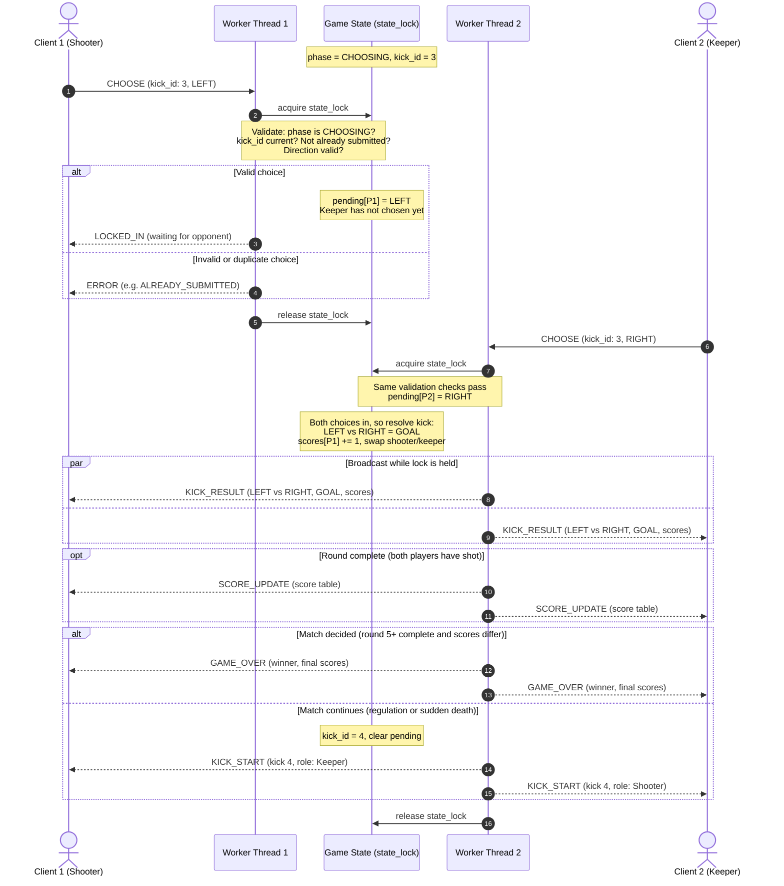

# Sprint 2: Concurrency & Game Behavior Design — Penalty Shootout

## 1. Concurrency Model: Multi-Threading (One Thread per Client)

The server uses **Option A: multi-threading** with Python's `socket` and `threading` modules.

- **Main thread:** binds the listening socket, then loops on `accept()`. Its only job is accepting connections, so it never blocks on any individual client.
- **Worker threads:** each accepted client gets its own `threading.Thread` running `handle_client(conn, player_id)`. That thread loops on a blocking `recv()` for its client only. A slow or idle player blocks only their own thread, never the server or the other player.
- **Player limit:** a match has exactly two players. The first client to connect is Player 1 (shoots first each round); the second is Player 2. When the second player connects, the match starts. A third connection receives `ERROR (GAME_FULL)` and is closed.
- **Threads are daemon threads** so the server process can shut down cleanly without waiting on blocked `recv()` calls.

**Why threading over `selectors`:** with only two clients, one thread per client keeps the receive logic simple (a plain blocking loop with no per-socket buffers managed by an event loop). The trade-off is that shared state must be protected explicitly, which Section 3 covers.

## 2. Shared Game State

Both worker threads read and write a single `GameState` object. Nothing else is shared.

| Field | Description |
|---|---|
| `players` | `{player_id: socket}` for connected players (max 2) |
| `phase` | `WAITING_FOR_PLAYERS`, `CHOOSING`, or `GAME_OVER` |
| `round` | Current round number (1–5 regulation, 6+ sudden death) |
| `kick_id` | Increments every kick; tags messages so stale ones can be rejected |
| `shooter`, `keeper` | Player IDs for the current kick; swapped after every kick |
| `pending` | `{player_id: direction or None}` — choices locked in for the current kick |
| `scores` | `{1: goals, 2: goals}` |
| `history` | List of per-round results (who scored), used for the score table |

Each worker thread also keeps its own receive buffer for message framing. Those buffers are thread-local and never shared, so they need no lock.

## 3. Thread Safety & Lock Strategy

### 3.1 The lock

A single `threading.Lock`, `state_lock`, protects all of `GameState`. Every read or write of game state, and every send to any client socket, happens while holding it.

```python
state_lock = threading.Lock()

def handle_client(conn, player_id):
    buffer = b""
    while True:
        data = conn.recv(4096)        # blocking, and NOT holding the lock
        if not data:
            handle_disconnect(player_id)
            return
        buffer += data
        while b"\n" in buffer:        # one JSON message per line
            line, buffer = buffer.split(b"\n", 1)
            with state_lock:          # validate + mutate + broadcast atomically
                process_message(player_id, line)
```

### 3.2 Acquisition rules

1. **Never hold the lock during `recv()`.** A thread waiting on its client while holding the lock would freeze the other player.
2. **Always acquire with `with state_lock:`** so the lock is released even if an exception occurs mid-update.
3. **Validation, state mutation, kick resolution, and broadcasting happen inside one critical section.** No other thread can observe a half-updated state.
4. **All socket sends happen under the lock**, including `ERROR` replies. This means two threads can never write to the same socket at the same time, so messages are never interleaved byte-by-byte.
5. **One lock only.** With a single lock there is no lock ordering to get wrong, so deadlock is impossible. With two players, contention is negligible, so finer-grained locks would add risk without benefit.

### 3.3 The race condition this prevents

Both players usually submit their choices at nearly the same instant. Resolving a kick requires "store my choice, then check whether the opponent has also chosen." Without a lock, the two threads can interleave badly:

- **Lost resolution:** Thread 1 checks (opponent missing), Thread 2 checks (opponent missing), then both store their choices. Neither thread resolves the kick and the game hangs.
- **Double resolution:** both threads store, then both check and see two choices. The kick is resolved twice, a goal is counted twice, and roles swap twice.

Because store-check-resolve runs inside one critical section, exactly one thread is always the second to submit, and only that thread resolves the kick and broadcasts the result.

### 3.4 Other shared-state hazards

- **Connect/disconnect:** adding or removing a player from `players` happens under the lock, so a broadcast never sends to a half-removed socket.
- **Disconnect mid-kick:** if a player drops while the other's choice is pending, the disconnect handler acquires the lock, sets `phase = GAME_OVER`, and notifies the remaining player. Any choice processed afterward fails validation because the phase is no longer `CHOOSING`.
- **Sends under the lock:** a `sendall()` to a slow client could in theory hold the lock longer. Messages are small (well under 1 KB), so this is not a practical concern for two players. If a send raises an exception, that player is treated as disconnected.

## 4. Turn (Kick) Enforcement

The server is the only authority on game state. Clients only submit choices; they never decide outcomes. Both players send the same message type (`CHOOSE`), and the server interprets each one according to that player's current role.

A `CHOOSE` message is accepted only if **all** of these hold. Otherwise the sender gets an `ERROR` and the state is not touched:

| Check | Error code |
|---|---|
| `phase == CHOOSING` | `NOT_ACCEPTING_CHOICES` |
| Message `kick_id` matches the current `kick_id` | `STALE_KICK` |
| The sender has not already submitted for this kick | `ALREADY_SUBMITTED` |
| Direction is `LEFT`, `CENTER`, or `RIGHT` | `INVALID_DIRECTION` |
| Message is valid JSON with the expected fields | `MALFORMED_MESSAGE` |

Choices are final once accepted; a player cannot change their pick. The server never sends either player's choice to the opponent until both are locked in, so neither player can react to the other's pick.

Because a kick is resolved inside the same critical section that accepted the second choice, no separate "resolving" phase is needed. A late message tagged with the old `kick_id` is rejected as `STALE_KICK`.

## 5. Message Protocol

Messages are newline-delimited JSON (one message per line), so the receiver can split a TCP byte stream into whole messages.

**Client → Server**

| Message | Fields | Purpose |
|---|---|---|
| `CHOOSE` | `kick_id`, `direction` | Lock in a shot or dive direction |
| `QUIT` | — | Leave the match (counts as forfeit) |

**Server → Client**

| Message | Fields | Purpose |
|---|---|---|
| `WELCOME` | `player_id` | Sent on connect |
| `KICK_START` | `kick_id`, `round`, `role` | New kick begins; tells each player whether they are shooting or keeping |
| `LOCKED_IN` | `kick_id` | Confirms the sender's choice; waiting on opponent |
| `KICK_RESULT` | `kick_id`, `shooter`, `shot`, `dive`, `goal`, `scores` | Reveals both choices and the outcome |
| `SCORE_UPDATE` | `round`, `scores`, `history`, `sudden_death` | Full score table, sent after each round |
| `GAME_OVER` | `winner`, `reason`, `scores` | Match finished (`reason`: `WIN` or `FORFEIT`) |
| `ERROR` | `code`, `message` | Rejected message; state unchanged |

## 6. Kick Synchronization Sequence Diagram



### Narrative

1. Player 1 (the shooter) locks in `LEFT`. Their worker thread acquires `state_lock`, validates the message, and stores the choice. Since the keeper hasn't chosen, Thread 1 replies `LOCKED_IN` and releases the lock. Player 2 is told nothing about Player 1's choice.
2. If Player 1 sends a second `CHOOSE` for the same kick (an out-of-turn move), validation fails with `ALREADY_SUBMITTED` and the state is unchanged.
3. Player 2 (the keeper) locks in `RIGHT`. Thread 2 acquires the lock, validates, stores the choice, and sees both choices are present. Still holding the lock, it resolves the kick (directions differ, so it's a goal), updates the score, and swaps roles.
4. Thread 2 sends the identical `KICK_RESULT` to both clients before releasing the lock, so no new kick can begin until both players have received the result.
5. If this was the second kick of a round, Thread 2 also broadcasts `SCORE_UPDATE`. It then either ends the match with `GAME_OVER` or starts the next kick with `KICK_START`, telling each player their new role.

## 7. Score & Leaderboard Synchronization

### 7.1 Storage

Scores live only in server memory inside `GameState`, protected by `state_lock`:

```python
scores  = {1: 0, 2: 0}                         # total goals per player
history = [{"round": 1, 1: True, 2: False},    # did each player score that round?
           ...]
```

Clients never keep authoritative scores; they display whatever the server last sent.

### 7.2 Broadcast logic

- **After every kick:** `KICK_RESULT` includes the current `scores`, so both scoreboards stay current kick-by-kick.
- **After every round** (both players have shot): the server appends the round to `history` and broadcasts `SCORE_UPDATE` with the full table and a `sudden_death` flag. Clients can render it like a real shootout scoreboard (goal or miss per round).
- **End-of-match check** (after each completed round):
  - Rounds 1–4: continue.
  - Round 5 or later: if `scores[1] != scores[2]`, broadcast `GAME_OVER`. Otherwise continue into (or stay in) sudden death. In sudden death this means the match ends the first round where one player scores and the other doesn't.

### 7.3 Synchronous delivery guarantee

Each broadcast payload is built once and sent with `sendall()` to Player 1, then Player 2, all inside the critical section that changed the state. Because the lock is not released until both sends finish:

- Both clients receive the **same** state, in the **same** order.
- No new choice can be accepted between the two sends.
- The `kick_id` in every message lets a client confirm it is looking at the latest state.

## 8. Disconnect Handling

When `recv()` returns empty bytes or raises an error, the worker thread acquires `state_lock` and removes the player.

- **During `WAITING_FOR_PLAYERS`:** the slot is freed and the server waits for a new player.
- **During a match:** `phase` becomes `GAME_OVER`, and the remaining player receives `GAME_OVER (reason: FORFEIT)` with them as the winner. Both connections are then closed.

Because this runs under the same lock as everything else, a disconnect can never interleave with a kick resolution.